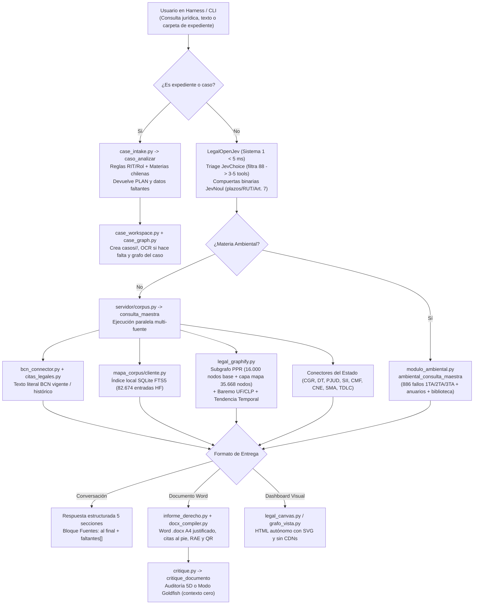

# Guía Maestra de Arquitectura y Funcionamiento Completo — Open Legal Chile (`v1.15.0`)

**Open Legal Chile — Un proyecto open source · Desarrollado por Pablo Benavides J. · Web: https://elpabloultron.github.io/open-legal-chile/**

> **Propósito de este manual:** Explicar en profundidad —con rigor de ingeniería de software y técnica forense chilena— cómo funciona internamente cada uno de los **62 módulos Python raíz**, **7 sub-despachadores MCP (`servidor/`)**, **13 módulos del Mapa del Corpus (`mapa_corpus/`)**, **19 agentes autónomos (`agents/`)**, **27 skills (`.agents/skills/`)**, **88 herramientas MCP** y **8 flujos de automatización (`.github/workflows/`)** que integran **Open Legal Chile**.

---

## Tabla de Contenidos

1. [Visión Sistémica y Filosofía Jurídica](#1-visión-sistémica-y-filosofía-jurídica)
2. [Flujo Completo de una Consulta (De la Pregunta al Dictamen)](#2-flujo-completo-de-una-consulta-de-la-pregunta-al-dictamen)
3. [Núcleo MCP, Despacho Modular (`servidor/`), CLI y Configuración](#3-núcleo-mcp-despacho-modular-servidor-cli-y-configuración)
4. [La Tríada Neuro-Simbólica: `LegalOpenJev`, `LegalGraphify` y `LegalCanvas`](#4-la-tríada-neuro-simbólica-legalopenjev-legalgraphify-y-legalcanvas)
5. [Motor Vectorial Híbrido, Búsqueda BM25F y Caché Local](#5-motor-vectorial-híbrido-búsqueda-bm25f-y-caché-local)
6. [El Mapa del Corpus en Hugging Face (`mapa_corpus/` — 13 Módulos)](#6-el-mapa-del-corpus-en-hugging-face-mapa_corpus--13-módulos)
7. [Los Conectores Oficiales del Estado de Chile y Fuentes Especializadas](#7-los-conectores-oficiales-del-estado-de-chile-y-fuentes-especializadas)
8. [Mesa de Entrada (`case_intake`), Espacios de Caso y Agentes Autónomos](#8-mesa-de-entrada-case_intake-espacios-de-caso-y-agentes-autónomos)
9. [Ingesta Doctrinal, Conversores Canónicos y Peritaje OCR](#9-ingesta-doctrinal-conversores-canónicos-y-peritaje-ocr)
10. [Redacción Forense, Compilación Word/PDF y Crítica Contradictoria (*Elephant-Goldfish*)](#10-redacción-forense-compilación-wordpdf-y-crítica-contradictoria-elephant-goldfish)
11. [Módulos de Especialidad: CBR, Vigilante Procesal, Examen de Grado, Clínica CAJ y Privacidad/INAPI](#11-módulos-de-especialidad-cbr-vigilante-procesal-examen-de-grado-clínica-caj-y-privacidadinapi)
12. [Catálogo Estructurado de las 88 Herramientas MCP, Agentes (19) y Skills (27)](#12-catálogo-estructurado-de-las-88-herramientas-mcp-agentes-19-y-skills-27)
13. [Ecosistema de Automatización, Cosecha Masiva y Auditoría 360° (`.github/workflows/`)](#13-ecosistema-de-automatización-cosecha-masiva-y-auditoría-360-githubworkflows)
14. [Límites Declarados y Compuertas Éticas del Sistema](#14-límites-declarados-y-compuertas-éticas-del-sistema)

---

## 1. Visión Sistémica y Filosofía Jurídica

**Open Legal Chile** resuelve un problema estructural de la inteligencia artificial aplicada al Derecho: los modelos de lenguaje grandes (*LLM*) genéricos son motores probabilísticos entrenados mayoritariamente sobre jurisprudencia y doctrina anglosajona (*Common Law*). Cuando un profesional les solicita analizar un despido laboral, un recurso de protección o una cláusula penal en Chile sin una infraestructura de anclaje normativo, el modelo tiende a:
1. Inventar artículos derogados o citar números de rol inexistentes (*alucinaciones*).
2. Importar figuras del *Common Law* prohibidas e inexistentes en Chile (*at-will employment*, *punitive damages*, *discovery*, *subpoena*).
3. Desconocer la doctrina administrativa vinculante (Contraloría General de la República, Dirección del Trabajo, Servicio de Impuestos Internos, Comisión para el Mercado Financiero).
4. Consumir miles de tokens leyendo manuales enteros, perdiendo precisión en el tramo medio del contexto.

Para erradicar esas cuatro fallas, el ecosistema opera bajo cinco principios de ingeniería jurídica:

* **Derecho Continental Codificado (*Civil Law*):** Primacía estricta de la ley escrita (*Art. 1 del Código Civil*), efecto relativo de las sentencias (*Art. 3 inc. 2 del Código Civil*) y léxico procesal oficial chileno.
* **No se cita sin texto literal:** Ninguna norma puede presentarse como citada por intuición. El sistema verifica el texto vigente en BCN o en su caché verificada (`cita_texto`) y declara «sin fuente verificable» cuando una pieza no pudo recuperarse.
* **Triangulación Tripartita Obligatoria:** Toda respuesta jurídica de fondo integra tres pilares: **Pilar Positivo** (BCN Ley Chile), **Pilar Dogmático** (tratados canónicos + dataset Hugging Face) y **Pilar Jurisprudencial/Administrativo** (PJUD, CGR, DT, SII, SMA, TDLC, CMF).
* **Arquitectura *Local-First* y *Zero Data Leak*:** El procesamiento de expedientes, el grafo ontológico (`LegalGraphify`), la búsqueda vectorial (`vector_engine.py`), los índices SQLite FTS5 (`doctrina.db`, `hf_cache_index.py`, `mapa_corpus/indice.py`), las compuertas procesales (`LegalOpenJev`) y la generación de documentos Word/HTML corren **localmente en la CPU del usuario**, resguardando el secreto profesional (*Art. 247 del Código Penal*) y la protección de datos personales (*Leyes N.° 19.628 y N.° 21.719*).
* **Interoperabilidad Universal vía MCP:** Toda la suite expone un único protocolo estándar **Model Context Protocol (MCP)** sobre `stdio` (JSON-RPC 2.0), operable desde **Google Antigravity**, **Claude Code**, **Claude Desktop**, **Cursor**, **VS Code (Copilot)**, **Gemini CLI**, **Codex**, **Hermes**, **OpenCode**, **dsh** y la consola interactiva propia **`openlegal`**.

---

## 2. Flujo Completo de una Consulta (De la Pregunta al Dictamen)

Cada etapa del flujo posee una responsabilidad acotada:
1. **Regla frente a intuición:** En `case_intake.py` y `legal_open_jev.py`, la detección de competencia, plazos fatales y herramientas necesarias se resuelve por código determinista en milisegundos, no delegándola a la aleatoriedad del LLM.
2. **Paso 0 garantizado:** El servidor precalienta en hilos en segundo plano las cachés más costosas (`data/legal_knowledge_graph.json`, el índice del mapa `mapa_corpus` y el listado de Hugging Face) sin bloquear el *handshake* MCP.
3. **Verificación de texto literal:** Antes de insertar una norma, `consulta_maestra` o `cita_texto` trae el artículo literal desde BCN Ley Chile (o desde su caché verificada), dejando constancia explícita en `faltantes[]` si alguna fuente falló.

---

## 3. Núcleo MCP, Despacho Modular (`servidor/`), CLI y Configuración

Este subsistema sostiene la columna vertebral de ejecución, interoperabilidad con *harnesses*, diagnóstico y telemetría.

### 3.1. Servidor Maestro y Sub-Despachadores (`mcp_server.py` y `servidor/*.py`)

| Archivo | Rol en la Arquitectura | Mecanismo Interno Clave |
| :--- | :--- | :--- |
| **`mcp_server.py`** *(1.049 L)* | Servidor FastMCP / JSON-RPC 2.0 sobre `stdio`. | Ensambla las **88 herramientas** desde `servidor/`, precalienta cachés en daemon threads (`precalentar_caches()`), soporta notificaciones `notifications/progress`, aplica perfiles temáticos (`OPENLEGAL_PROFILE`), poda respuestas grandes (`ajustar_salida`) y despacha `handle_tool_call(name, args)`. |
| **`servidor/__init__.py`** *(7 L)* | Registro modular de dominios. | Centraliza la interfaz uniforme `TOOLS` + `despachar(name, args)` en cada dominio. |
| **`servidor/corpus.py`** *(863 L · 19 tools)* | Protocolo de citas, doctrina y grafo. | Implementa `consulta_maestra`, `cita_texto` (con lotes `referencias`), `busqueda_universal`, `doctrina_*`, `huggingface_search_dataset`, `academia_judicial_buscar_guias`, `biblioteca_compilar_manifiesto`, `grafo_ver_*`, `generar_grafo_vinculos` y las 6 herramientas `graphify_*`. Cada llamada usa `_refrescar()` para ver los clientes vivos y mocks de `mcp_server`. |
| **`servidor/conectores.py`** *(793 L · 28 tools)* | Acceso directo a organismos públicos. | Expone las herramientas de BCN (vigente e histórico), CGR (dictámenes y auditorías), DT, CNE, Panel de Expertos, CMF, SII (8 herramientas especializadas), SMA, TDLC, PJUD (Corte Suprema, TC, Salud, Extranjería, DD.HH., Líneas CS, Género y Baremo Daño Moral), InfoProbidad, RUT y Entes Públicos. |
| **`servidor/casos.py`** *(283 L · 10 tools)* | Orquestación de casos, agentes y NotebookLM. | Expone `caso_analizar`, `caso_ejecutar`, `agent_list`, `agent_run`, `agent_export_subagents`, `entrevista_estudio` y los 4 conectores `notebooklm_*`. |
| **`servidor/forense.py`** *(752 L · 22 tools)* | Litigación, OCR, documentos, grado y clínica. | Despacha `ocr_plan_documento`, `ocr_extract_pdf`, `critique_documento`, `generar_documento`, `export_brief_ojv`, `compile_legal_dossier`, `recurso_proteccion_generar`, `cpc_validar_mandato`, `cbr_*`, `grado_*`, `clinica_*`, `vigilante_*`, `privacidad_tramitar_arco` e `inapi_*`. |
| **`servidor/ambiental.py`** *(71 L · 2 tools)* | Módulo especializado ambiental. | Implementa `ambiental_buscar_jurisprudencia` y el orquestador unificado `ambiental_consulta_maestra`. |
| **`servidor/suite.py`** *(180 L · 7 tools)* | Mantenimiento e introspección del producto. | Despacha `suite_doctor`, `suite_instalar`, `skills_listar`, `skill_ver`, `suite_telemetria_stats`, `suite_verificar_actualizacion` y `suite_auto_update`. |

### 3.2. Consola CLI, Configuración, Diagnóstico e Instaladores

* **`openlegal.py`** *(1.443 L)*: Punto de entrada CLI oficial (`openlegal` y `openlegal-mcp`). Posee un **menú interactivo de 21 opciones (0–20)** más subcomandos declarativos modernos: `openlegal mcp`, `openlegal doctor` (diagnóstico medido sin falsos positivos), `openlegal instalar` (configuración integral y plugin Antigravity), `openlegal integrar <cliente>`, `openlegal graph <tema>`, `openlegal agent <list|run|chat|export>`, `openlegal casos`, `openlegal entrevista` y `openlegal actualizar`.
* **`config.py`** *(332 L)*: Gestor transversal de configuración y resiliencia. Carga variables desde `.env` sin sobrescribir secretos externos, valida esquemas de URL seguros mediante `safe_urlopen` (bloqueo de esquemas no HTTP/HTTPS), gestiona TTL de cachés locales (`cache_fresco`), lee el módulo servidor activo (`servidor_actual`) y mide tiempos por operación (`registrar_tiempo`, `tiempos_resumen`).
* **`recursos.py`** *(45 L)*: Localiza recursos no-código (`.agents/skills/`, `agents/`, `AGENTS.md`, `docs/`) tanto en un repositorio clonado como dentro de una instalación limpia desde `pip`/PyPI (`site-packages/openlegal_chile_data/`).
* **`integraciones_harness.py`** *(421 L)*: Configurador universal para *harnesses*. Detecta clientes instalados (`claude`, `claude-desktop`, `antigravity`, `gemini`, `cursor`, `vscode`, `codex`, `hermes`, `opencode`, `dsh`), escribe sus archivos de configuración MCP en alcance de proyecto o global (`--escribir --global`) y empaqueta e instala el **Plugin Nativo de Google Antigravity** en `~/.gemini/config/plugins/open-legal-chile/` (manifest, 27 skills, 19 agentes, reglas RAE y logo SVG) mediante `instalar_plugin_antigravity()`.
* **`diagnostico.py`** *(299 L)*: Implementación real de `suite_doctor` / `openlegal doctor`. A diferencia de verificadores cosméticos, inspecciona en disco versión exacta, motores OCR reales (`pypdf`/`pdftotext` + `tesseract`/`rapidocr`), estado de `doctrina.db` (FTS5), existencia y nodos de `data/legal_knowledge_graph.json`, estado de descarga e índice de `mapa_corpus`, caché BCN, registro de las 88 herramientas MCP y presencia del token opcional de Hugging Face.
* **`cold_start.py`** *(190 L)*: Ejecuta la entrevista de arranque (*Cold-Start Interview*, vía CLI o herramienta `entrevista_estudio`) para guardar el perfil del abogado o estudio (áreas de práctica preferidas, fuero habitual, formato de salida) en `~/.openlegal/estudio_perfil.json`.
* **`chat_engine.py`** *(554 L)*: Motor de chat agéntico ReAct independiente del IDE (`LegalChatEngine`), capaz de conectarse a **Ollama local** (100 % offline), Anthropic Claude, Google Gemini, OpenAI o DeepSeek, inyectando contexto doctrinal y normas BCN mediante `get_relevant_legal_context()`.
* **`stats_tracker.py`** *(203 L)* y **`update_checker.py`** *(188 L)*: Consultan descargas públicas en PyPI y actividad en GitHub, verifican nuevas versiones con caché temporal no intrusiva y ejecutan actualizaciones seguras (`run_auto_update`).
* **`setup.py`** y **`pyproject.toml`**: Empaquetado declarativo PEP 517/621 del paquete `openlegal-chile`, declaración de los 62 módulos raíz, submódulos `servidor/` y `mapa_corpus/`, *entry points* (`openlegal`, `openlegal-mcp`) y datos empaquetados para instalación limpia en PyPI.

---

## 4. La Tríada Neuro-Simbólica: `LegalOpenJev`, `LegalGraphify` y `LegalCanvas`

Open Legal Chile aplica una arquitectura cognitiva de doble proceso para combinar velocidad determinista, comprensión estructural profunda y entrega visual comprensible:

### 4.1. ⚡ `LegalOpenJev` (`legal_open_jev.py` — Sistema 1, < 5 ms en CPU)
Inspirado en el pensamiento rápido de Kahneman, evalúa cada consulta localmente en menos de 5 milisegundos sin llamar a ningún LLM externo:
1. **`JevChoice`:** Clasifica la materia (`laboral`, `civil_contratos`, `inmobiliario_cbr`, `ambiental`, `constitucional_proteccion`, `administrativo_cgr`, `tributario_sii`, `financiero_cmf`, `libre_competencia_tdlc`, `energia_cne`, `propiedad_intelectual_privacidad`, `familia_clinica`) y filtra el catálogo de 88 herramientas MCP a un núcleo de **3 a 5 herramientas pertinentes**, ahorrando contexto al agente.
2. **`JevNoul`:** Aplica compuertas binarias (*pass/fail*) matemáticas e inapelables antes de redactar:
   * Caducidad laboral (*Art. 168 Código del Trabajo*: 60 días hábiles desde la separación, ampliables hasta 90 con reclamo administrativo DT).
   * Recurso de protección (*Auto Acordado CS Acta N.° 94-2015*: 30 días corridos fatales).
   * Prescripción civil (*Arts. 2514, 2515 y 2332 Código Civil*).
   * Cómputo estricto de feriados nacionales chilenos (`FERIADOS_CHILE_FIJOS`) y días hábiles judiciales (*Art. 66 CPC*).
   * Validación de RUT (Módulo 11) y suficiencia de facultades especiales de mandato (*Art. 7 inc. 2 CPC*).
3. **`JevDecision` y `JevScore`:** Puntúan relevancia de pasajes candidatos en CPU local.

### 4.2. 🧠 `LegalGraphify` (`legal_graphify.py` — 3.453 L, Sistema 2 Ontológico)
Es el motor de grafo de conocimiento multidimensional que evita inyectar libros completos en la ventana del LLM:
* **Topología Curada Base ([`data/legal_knowledge_graph.json`](file:///home/pablo/Escritorio/Archivador/open-legal-chile/data/legal_knowledge_graph.json)):** **`16.000` nodos y `44.838` aristas** que enlazan instituciones dogmáticas, tratados y revistas, normas BCN/CPR, órganos públicos, vías procesales, **886** sentencias ambientales y los **1.553 registros especializados PJUD** (incluidos los **17 tramos de parentesco del Baremo Daño Moral en UF/CLP**).
* **Fusión en Tiempo Real con la Capa del Mapa (`mapa_corpus`):** Mediante `subir_capa_mapa()`, se acopla al grafo publicado la capa conectora generada desde los ~82 mil archivos de Hugging Face (`35.668` nodos y `167.444` aristas totales en la capa del mapa), permitiendo navegar por roles de Corte Suprema (`cs:*`), TC (`tc:*`), Tribunales Ambientales (`ta:*`), artículos legales (`norma:*`), ministros (`ministro:*`), salas (`sala:*`) y publicaciones especializadas (`baremo:*`, `lineas:*`, `salud:*`, `extranjeria:*`, `ddhh:*`, `genero:*`).
* **Motores de Ciencia de Datos en Grafos:**
  1. **Resolución de Nodos por Especificidad IDF:** Al buscar un término, `_buscar_nodo_relevante` pondera los tokens por su frecuencia inversa de documento ($\log((N+1)/(df+1)) + 1$), evitando que palabras genéricas como «derecho» o «civil» opaquen conceptos exactos (*«simulación»*, *«precario»*, *«baremo daño moral abuelo»*).
  2. **Personalized PageRank (`ranking_ppr_subgrafo`, $\alpha=0.85$):** Ejecuta *Random Walk with Restart* sobre el ego-subgrafo de 2 saltos (acotado a $\le 250$ nodos) para identificar las normas, fallos e instituciones topológicamente más centrales en menos de 2 ms.
  3. **Análisis Temporal y Cuantificación Baremo (`analizar_tendencia_y_baremo`):** Integrado en `explicar_institucion()` y `analizar_impacto_normativo()`. Calcula la distribución anual y por sala/tribunal de la jurisprudencia conectada, computa un **índice de vigencia temporal con decaimiento exponencial** (`DOCTRINA_RECIENTE_ACTIVA`, `CRITERIO_CONSOLIDADO`, `DOCTRINA_HISTORICA`), y extrae automáticamente los rangos estadísticos del **Baremo PJUD en UF y CLP** (mediana 1.ª Instancia, P25–P75, Corte de Apelaciones y Corte Suprema).
  4. **Compresión Extrema y Determinista de Contexto:** `consultar_subgrafo` entrega fichas YAML estables y ordenadas con afinidad léxica (`_ordenar_vecinos`), logrando una reducción mediana medida del **99,9 % de tokens** (mediana de `91` tokens frente a `96.536` tokens de la obra doctrinal íntegra). Además exporta subgrafos en **Mermaid** (`exportar_subgrafo_mermaid`) con alias seguros y trazabilidad completa de rutas (`encontrar_camino`) y *Blast Radius* ante reformas (`analizar_impacto_normativo`).

### 4.3. 🎨 `LegalCanvas`, `grafo_vista.py` y `grafo_vinculos.py`
* **`legal_canvas.py`** *(813 L)*: Renderiza dashboards de análisis forense (*carátula, línea de tiempo SVG, semáforo de plazos fatales, checklist de prueba Art. 1698 CC y cajón click-to-copy de citas oficiales*) en un **único archivo HTML autónomo sin CDNs externos**.
* **`grafo_vista.py`** *(373 L)*: Materializa las vistas interactivas (`grafo_ver_corpus` y `grafo_ver_caso`) en HTML autocontenido navegable en cualquier navegador.
* **`grafo_vinculos.py`** *(158 L)*: Construye redes relacionales de personas naturales, sociedades, autoridades y causas para investigación de probidad y conflictos de interés (`generar_grafo_vinculos`).

---

## 5. Motor Vectorial Híbrido, Búsqueda BM25F y Caché Local

1. **`vector_engine.py`** *(398 L — `VectorLegalEngine` + `SemanticEmbeddingEngine`)*: Indexa localmente los **9 Códigos de la República y la Constitución Política** en SQLite (`codigos_vectorial.db`). Combina embeddings vectoriales de 384 dimensiones en CPU local (ONNX si está disponible o proyección determinista de subpalabras y trigramas ortogonales sin depender de GPU ni APIs) con búsqueda léxica SQLite **FTS5 BM25**, fusionando ambos rankings mediante **Reciprocal Rank Fusion (RRF)** a costo $0 y sin fuga de datos.
2. **`online_library_sync.py`** *(2.688 L — `OnlineLibrarySyncManager`)*: Gestiona la sincronización y búsqueda ultrarrápida sobre el dataset público `pablobenavidesj/doctrina-jurisprudencia-chile` en Hugging Face. Implementa un motor **Okapi BM25F ponderado por campos** (`título ×3.5`, `palabras clave ×2.5`, `ruta ×1.8`, `extracto ×1.0`, con $k_1 = 1.5, b = 0.75$), índice invertido de **4-gramas** de caracteres para tolerancia morfológica, caché local inteligente en `~/.openlegal/hf_cache/` con verificación por `blob_id` TTL 12h, resolución paralela con `ThreadPoolExecutor(max_workers=4)` y gestión segura de tokens en `~/.openlegal/hf_token` (`chmod 0600`).
3. **`hf_cache_index.py`** *(115 L)*: Mantiene un índice local SQLite FTS5 con tokenizador **`trigram`** sobre el corpus descargado para resolver búsquedas por subcadena exactas (insensibles a acentos) en milisegundos.
4. **`citas_legales.py`** *(985 L)*: Gramática única y canónica de citación y normalización de todo el proyecto (`formatear_cita`, `detectar_normas`, `normas_y_roles`). Convierte expresiones libres (*«art. 1545 del Código Civil»*, *«Ley N° 21.643 artículo 2»*, *«STC Rol 2402»*, *«CS Rol 10641-2024»*) en IDs canónicos únicos compartidos por `consulta_maestra`, `mapa_corpus` y `legal_graphify`.

---

## 6. El Mapa del Corpus en Hugging Face (`mapa_corpus/` — 13 Módulos)

A medida que el repositorio en Hugging Face superó los **80.000 archivos** (70.523 fallos CS, 1.430+ TC, 886 TA, 7.398 documentos de doctrina/revistas, 1.553 fallos especializados PJUD/Baremo), listar e inspeccionar archivos uno a uno era inviable. Para resolverlo, el paquete **`mapa_corpus/`** implementa un índice precalculado y verificable criptográficamente:

| Módulo | Función Dentro del Pipeline del Mapa |
| :--- | :--- |
| **`mapa_corpus/__init__.py`** | Exporta la API del paquete y define su contrato con el servidor MCP y `LegalGraphify`. |
| **`mapa_corpus/ids.py`** *(157 L)* | Genera IDs deterministas sin colisiones (`cs:<rol>`, `tc:<num>`, `ta:<1ta\|2ta\|3ta>:<rol>`, `doc:<subruta>`, `baremo:*`, `lineas:*`, `salud:*`, `extranjeria:*`, `ddhh:*`, `genero:*`, `ministro:*`, `sala:*`, `autor:*`, `norma:*`) usando `citas_legales.py` como gramática única. |
| **`mapa_corpus/texto.py`** *(186 L)* | Parser tolerante para front-matter YAML, listas JSON en línea, viñetas Markdown, normalización Unicode y extracción de fechas judiciales en palabras (*«Santiago, seis de mayo de dos mil veintidós»*). |
| **`mapa_corpus/extractores.py`** *(446 L)* | Extractores puros `(ruta, bytes) -> fila` para cada colección del dataset: Corte Suprema (`fila_cs`), Tribunal Constitucional (`fila_tc`, identificando desalineaciones cabecera vs. cuerpo), Tribunales Ambientales (`fila_ta`), portales especializados PJUD y Baremo (`fila_pjud_especializada`), revistas y doctrina (`fila_doc`), guías/biblioteca/publicaciones (`fila_simple`) e inventario (`fila_archivo`). |
| **`mapa_corpus/particiones.py`** *(134 L)* | Agrupa y serializa filas en particiones `.jsonl.gz` deterministas (incluidas `entradas/pjud-baremo`, `pjud-lineas`, `pjud-salud`, `pjud-extranjeria`, `pjud-ddhh`, `pjud-genero`). Misma entrada garantiza bytes idénticos. |
| **`mapa_corpus/inventario.py`** *(234 L)* | Consulta la API de Hugging Face por `blob_git`, detecta qué cambió desde el último snapshot (`delta`) y descarga únicamente los archivos nuevos/modificados respetando límites de cuota. |
| **`mapa_corpus/constructor.py`** *(444 L)* | Ejecuta la construcción incremental o completa, resuelve colisiones de IDs, valida invariantes y emite métricas agregadas por colección. |
| **`mapa_corpus/grafo.py`** *(304 L)* | Construye la capa conectora `grafo_base.json` (`35.668` nodos y `167.444` aristas, `66` comunidades) uniendo documentos, normas BCN, roles citados, ministros, salas y alias curados con `data/legal_knowledge_graph.json`. |
| **`mapa_corpus/indice.py`** *(252 L)* | Arma en el equipo del usuario una base SQLite FTS5 de solo lectura a partir de las particiones comprimidas descargadas (`entradas`, `entidades`, `citas`). |
| **`mapa_corpus/publicador.py`** *(149 L)* | Sube el mapa a Hugging Face (`data/mapa/`) en un solo commit atómico etiquetado (`mapa-<n>`) y escribe el puntero oficial en [`mapa_corpus/puntero.json`](file:///home/pablo/Escritorio/Archivador/open-legal-chile/mapa_corpus/puntero.json) (actualmente en revisión `a7ce3f5d2d1e24f8ea84908ff964cb194ddc2bb7`, **82.674 entradas**). |
| **`mapa_corpus/verificacion.py`** *(47 L)* | Verifica la integridad SHA-256 y coherencia del puntero publicado (usada por CI y pos-publicación). |
| **`mapa_corpus/cliente.py`** *(362 L)* | Cliente local del mapa (`MapaCliente` singleton): descarga verificada una sola vez por revisión, consultas en < 10 ms por rol, norma, colección o entidad sin tráfico de red repetido y citación con URL fijada al commit exacto del dataset. |
| **`mapa_corpus/__main__.py`** *(349 L)* | CLI de administración del constructor (`python -m mapa_corpus <estado|construir|validar|publicar|puntero|actualizar|verificar-puntero>`). |

---

## 7. Los Conectores Oficiales del Estado de Chile y Fuentes Especializadas

Todos los conectores heredan buenas prácticas de resiliencia (caché local con expiración controlada, encabezados HTTP legítimos, parsing XML/JSON nativo y formateo oficial de corchetes `[Organismo - ...]`), sin requerir claves comerciales:

| Conector (Archivo) | Fuente Oficial del Estado / Origen | Capacidades Principales |
| :--- | :--- | :--- |
| **`bcn_connector.py`** *(616 L)* | Biblioteca del Congreso Nacional (`bcn.cl/leychile` XML) | Textos vigentes de leyes y los 9 Códigos de la República (`bcn_get_codigo`, `bcn_get_ley`), más **reconstrucción normativa histórica** a cualquier fecha pasada `YYYY-MM-DD` (`bcn_get_ley_historica`, `bcn_get_codigo_historico`). |
| **`pjud_connector.py`** *(973 L)* | Poder Judicial (`juris.pjud.cl`, `baremo.pjud.cl`, `secretariadegenero.pjud.cl`, `busddhh.pjud.cl`, TC) | Búsqueda unificada sobre **70.523+ sentencias CS**, **966+ TC** y las **6 nuevas colecciones especializadas** (`lineas` [457], `salud` [311], `extranjeria` [162], `ddhh` [418], `genero` [188]) más **`consultar_baremo_dano_moral`** (17 categorías de parentesco sobre 2.137 fallos con medianas, promedios y P25–P75 en **UF y CLP**). Analiza también nomenclatura RIT (`analizar_rit`). |
| **`cgr_connector.py`** *(503 L)* | Contraloría General de la República | Jurisprudencia administrativa vinculante (`cgr_search_jurisprudencia`) y catálogo de más de 9.600 informes finales de auditoría (`cgr_search_auditorias`). |
| **`dt_connector.py`** *(540 L)* | Dirección del Trabajo | Dictámenes y ordinarios laborales vigentes (`dt_search_doctrina`: Ley Karin 21.643, 40 Horas 21.561, despidos, semana corrida, subcontratación). |
| **`sii_connector.py`** *(1.277 L)* | Servicio de Impuestos Internos | El conector tributario más extenso de la suite (8 herramientas MCP): circulares, resoluciones exentas y oficios ordinarios por año, descarga/lectura directa de PDFs oficiales, actos regionales, convenios de doble tributación y jurisprudencia tributaria judicial TTA/CS. |
| **`cmf_connector.py`** *(510 L)* | Comisión para el Mercado Financiero | Normas de Carácter General (NCG), circulares y registro oficial de resoluciones sancionatorias (`cmf_search_normativa`, `cmf_buscar_sanciones`). |
| **`cne_connector.py`** *(273 L)* y **`panel_expertos_connector.py`** *(309 L)* | Comisión Nacional de Energía & Panel de Expertos LGSE | Registro de centrales generadoras, proyectos energéticos en evaluación ambiental (`region` filter) y discrepancias/dictámenes técnicos-tarifarios del sector eléctrico (DFL 4/2006 y Ley 20.936). |
| **`ambiental_connector.py`** *(298 L)*, **`tribunales_ambientales_connector.py`** *(242 L)* y **`modulo_ambiental.py`** *(375 L)* | SMA (SNIFA) & 1TA / 2TA / 3TA + Biblioteca Ambiental | Expedientes sancionatorios SMA (`sma_search_sancionatorios`), 886 sentencias de Tribunales Ambientales (`ambiental_buscar_jurisprudencia`), y el orquestador maestro `ambiental_consulta_maestra` que unifica fallos TA, anuarios, boletines, Concurso Nacional, informes en derecho y subgrafo ambiental. |
| **`tdlc_connector.py`** *(346 L)* | Tribunal de Defensa de la Libre Competencia | Sentencias contenciosas, Instrucciones de Carácter General (ICG) y dictámenes no contenciosos bajo el DL N.° 211. |
| **`infoprobidad_connector.py`** *(152 L)* | InfoProbidad (CGR / CPLT — Ley N.° 20.880) | Extracción y auditoría estructurada de Declaraciones de Intereses y Patrimonio (DIP) de autoridades públicas. |
| **`entes_publicos.py`** *(269 L)* | Directorio Orgánico del Estado + Algoritmo Módulo 11 | Consulta competencias legales, ley orgánica y recursos contra órganos del Estado (`entes_consultar_organo`), y valida/formatea RUTs chilenos (`rut_validar_chile`). |
| **`doctrina_connector.py`** *(744 L)* | SQLite FTS5 BM25 sobre Tratados y Revistas (`doctrina.db`) | Busca, lista obras e indexa el canon doctrinal chileno (`doctrina_search`, `doctrina_get_institucion`, `doctrina_list_obras`). |
| **`academia_judicial_connector.py`** *(250 L)* | Guías Oficiales de la Academia Judicial de Chile | Búsqueda en las guías oficiales de conducción de audiencias y buenas prácticas judiciales (civil, familia, laboral, penal). |
| **`notebooklm_connector.py`** *(178 L)* | Google NotebookLM CLI/MCP Bridge | Crea cuadernos de investigación jurídica (`notebooklm_*`), carga expedientes y realiza consultas con citas ancladas (*grounded*). |

---

## 8. Mesa de Entrada (`case_intake`), Espacios de Caso y Agentes Autónomos

* **`case_intake.py`** *(922 L)*: Implementa la «Mesa de Entrada» natural (`caso_analizar`, `caso_ejecutar`, `caso_estudio_completo`). Detecta mediante reglas deterministas (`LETRAS_RIT`, `PATRONES_ROL`, `INSTITUCIONES` y catálogo `MATERIAS`) si el caso ingresado corresponde a materia laboral, civil, ambiental, penal, familia, tributaria, administrativa, energía, libre competencia, inmobiliaria o marcas/privacidad. Si faltan datos críticos (RUT, fecha de notificación o Rol), **ordena pedirlos al abogado en vez de adivinarlos**, y señala expresamente que el estado procesal privado de causas en OJV requiere ClaveÚnica del usuario.
* **`case_workspace.py`** *(272 L)* y **`case_graph.py`** *(301 L)*: Crean un directorio aislado por expediente en `casos/<id_caso>/`, almacenan antecedentes normalizados a Markdown, extraen entidades (`extraer_entidades_de_markdown`) y construyen el grafo ontológico propio de la causa (`CaseGraphEngine`) conectado al saber doctrinal general.
* **`agents_runtime.py`** *(1.219 L)*: Orquestador de los **19 agentes jurídicos autónomos** definidos en `agents/*.json`. Soporta dos modos de ejecución:
  * **Modo Determinista Soberano (100 % offline, `$0`):** Pipelines programados por perfil sin llamadas externas.
  * **Modo ReAct asistido por LLM:** Ciclo iterativo *Pensamiento ➔ Invocación de Herramienta MCP ➔ Observación*. También genera los subagentes en Markdown para Claude Code y Antigravity (`subagente_markdown` / `agent_export_subagents`).

---

## 9. Ingesta Doctrinal, Conversores Canónicos y Peritaje OCR

Todo documento crudo externo —tratado PDF, expediente escaneado, sentencia o dictamen— puede asimilarse en formato canónico limpio e indexarse de inmediato:

* **`doc2md_ingestor.py`** *(613 L)*: Limpia cortes de línea y guiones de fin de página (`clean_unwanted_hyphens_and_breaks`), aplica normas RAE/ASALE (`apply_ortotipografia_rae_chile`), estandariza corchetes de citación (`standardize_legal_citations`), extrae tablas nativas de PDFs con `pymupdf`, segmenta instituciones dogmáticas, guarda el Markdown y actualiza al instante `doctrina.db` (FTS5) y el grafo `LegalGraphify`.
* **`ingesta_fuentes.py`** *(326 L)*: Ingesta por lotes desde `doctrina_raw/` hacia carpetas temáticas de `doctrina/`.
* **`sentencia2md.py`** *(323 L)* y **`sentencias_parser.py`** *(391 L)*: Segmentan sentencias judiciales en su estructura legal obligatoria del **Art. 170 CPC** (*Expositiva / Vistos, Considerativa, Resolutiva*) y traducen proveídos frecuentes de OJV (*«Por interpuesta la demanda, traslado», «A lo principal, autos», «Recíbese la causa a prueba»*) junto a sus cargas y plazos procesales (`ProveidosParser`).
* **`resolucion_administrativa2md.py`** *(246 L)*, **`resoluciones_parser.py`** *(268 L)*, **`dictamen2md.py`** *(25 L)* y **`dictamenes_parser.py`** *(14 L)*: Equivalentes anatómicos para dictámenes e instructivos administrativos (CGR, DT, SII, CMF, SMA).
* **`forensic_ocr.py`** *(425 L)* y **`ocr_decision.py`** *(117 L)*: Evalúan primero el PDF con señales reales (`senales_del_pdf`: páginas, densidad de texto nativo, rotación, presencia de sellos o escaneo) para recomendar el plan óptimo sin gastar cómputo innecesario (`ocr_plan_documento`), y aplican extracción de texto nativo (`pymupdf` / `pdftotext`) o OCR de precisión con preservación de fojas judiciales (`ocr_extract_pdf`).

---

## 10. Redacción Forense, Compilación Word/PDF y Crítica Contradictoria (*Elephant-Goldfish*)

* **`informe_derecho.py`** *(463 L)*: Generador de Informes en Derecho extensos (`tipo="informe"` en `generar_documento`). Aplica el estándar de **Triangulación Tripartita**, busca doctrina/jurisprudencia en el corpus cuando no se aporta manualmente, **detecta y transcribe íntegramente el texto literal de cada artículo citado** desde BCN con su enlace y cita oficial al pie, evitando citas de memoria.
* **`docx_compiler.py`** *(279 L — `WordDossierCompiler`)*: Compila todo escrito o informe a **Word (`.docx` editable)** en hoja **A4 u Oficio chileno** (nunca *US Letter*), tipografía Times New Roman 12, **texto 100 % justificado**, normalización RAE/ASALE automática (`« »`, `N.°`, `—`, `$ 1.000.000`), membrete institucional superior, pie de página oficial de **Open Legal Chile** y **código QR** embebido hacia la web del proyecto.
* **`exporters.py`** *(547 L)* y **`recurso_proteccion.py`** *(628 L)*: Generan demandas civiles, demandas laborales, contratos PPA y **Recursos de Protección estandarizados bajo el Auto Acordado CS Acta N.° 94-2015** con presuma OJV (Ley N.° 20.886), comparecencia, hechos, derecho y otrosíes (`export_brief_ojv`, `recurso_proteccion_generar`).
* **`pdf_dossier_compiler.py`** *(285 L — `LegalDossierCompiler`)*: Ensambla expedientes completos en PDF A4 listos para acompañar en tribunales, agregando **portadas separadoras institucionales** por anexo, foliado digital, tabla de contenidos con marcadores y exportación dual (*alta resolución para tribunal* / *compresión ligera para móvil*).
* **`critique.py`** *(377 L — `LegalCritiqueEngine`)*: Auditor forense previo a la firma e ingreso del escrito. Opera en dos modos:
  1. **Modo `5d` (Estándar):** Audita hechos, derecho vigente, carga de la prueba (*Art. 1698 CC*), requisitos procesales (*Art. 254 CPC / Acta 94-2015*) y estrategia.
  2. **Modo `goldfish` (Modelo Contradictorio *Elephant-Goldfish*, inspirado en `google/elephant-goldfish-model`):** Aísla completamente al revisor del contexto y sesgo de confirmación del agente redactor (*Elefante*) para atacar el borrador como contraparte y ministro de admisibilidad (ineptitud del libelo *Art. 303 N.° 4 CPC*, caducidad/prescripción, personería *Art. 7 CPC*, orfandad probatoria y coherencia de peticiones concretas).

---

## 11. Módulos de Especialidad: CBR, Vigilante Procesal, Examen de Grado, Clínica CAJ y Privacidad/INAPI

* **`cbr_titles.py`** *(297 L — `CBRTitleStudyEngine`, `JudicialPowerVerifier`)*: Audita cadenas de títulos de dominio inmobiliario a **10 años** conforme a la prescripción adquisitiva extraordinaria (*Arts. 2510 y 2511 del Código Civil*), detecta hipotecas, gravámenes y prohibiciones CBR, verifica el checklist registral obligatorio (`cbr_checklist_documentos`) y audita mandatos judiciales y escrituras bajo el **Art. 7 del CPC** (`cpc_validar_mandato`).
* **`docket_watcher.py`** *(149 L — `DocketWatcherEngine`)*: Interpreta resoluciones OJV (`vigilante_analizar_resolucion`), calcula vencimientos fatales en días hábiles judiciales descontando domingos y feriados (*Art. 59 y 66 CPC*), rastrea publicaciones regulatorias (`vigilante_radar_normativo`) y controla ventanas de renovación o preaviso contractual (`vigilante_contrato_plazos`).
* **`examen_grado.py`** *(216 L — `ExamenGradoEngine`)*: Simulador socrático de Examen de Grado en Derecho Civil y Procesal. Sortea cédulas temáticas (`grado_generar_cedula`), interroga con exigencia de definiciones legales al pie de la letra y rúbrica tripartita (`grado_interrogar`), y entrega tarjetas mnemotécnicas (`grado_obtener_flashcards`).
* **`clinica_juridica.py`** *(144 L — `ClinicaJuridicaEngine`)*: Herramienta social orientada a Corporaciones de Asistencia Judicial (CAJ) y clínicas universitarias. Traduce resoluciones densas a **Lenguaje Claro** (`clinica_lenguaje_claro`, p. ej. *«téngase presente»* ➔ *«el tribunal leyó su documento y lo dejó registrado»*), genera fichas sociojurídicas con evaluación de **privilegio de pobreza** (*Arts. 591–600 COT* y *129–137 CPC*) y audita borradores de pasantes.
* **`privacidad_inapi.py`** *(126 L — `PrivacyARCOEngine`, `INAPIEngine`)*: Tramita solicitudes de **Derechos ARCO+** conforme a la **Ley N.° 19.628** y la **nueva Ley N.° 21.719** (`privacidad_tramitar_arco`), evalúa factibilidad y distintividad marcaria bajo la Ley N.° 19.039 (`inapi_evaluar_marca`) y redacta cartas de cese y desistimiento (`inapi_cease_and_desist`).

---

## 12. Catálogo Estructurado de las 88 Herramientas MCP, Agentes (19) y Skills (27)

### 12.1. Distribución de las 88 Herramientas MCP por Módulo Despachador

| Sub-módulo (`servidor/`) | Cantidad | Herramientas MCP Exactas |
| :--- | :---: | :--- |
| **`servidor/corpus.py`** | **19** | `consulta_maestra`, `cita_texto`, `busqueda_universal`, `grafo_ver_corpus`, `grafo_ver_caso`, `generar_grafo_vinculos`, `doctrina_search`, `doctrina_get_institucion`, `doctrina_list_obras`, `doctrina_ingestar_documento`, `academia_judicial_buscar_guias`, `biblioteca_compilar_manifiesto`, `huggingface_search_dataset`, `graphify_resumen_comunidades`, `graphify_consulta_subgrafo`, `graphify_trazar_camino`, `graphify_explicar_institucion`, `graphify_analizar_impacto`, `graphify_god_nodes` |
| **`servidor/conectores.py`** | **28** | `bcn_get_codigo`, `bcn_get_ley`, `bcn_get_ley_historica`, `bcn_get_codigo_historico`, `cgr_search_jurisprudencia`, `cgr_search_auditorias`, `dt_search_doctrina`, `cne_get_centrales_y_proyectos`, `panel_expertos_search`, `cmf_search_normativa`, `cmf_buscar_sanciones`, `sii_search_circulares`, `sii_buscar_resoluciones_y_oficios`, `sii_oficios_por_anio`, `sii_descargar_oficio`, `sii_leer_documento`, `sii_actos_regionales`, `sii_convenios_internacionales`, `sii_jurisprudencia_judicial`, `sma_search_sancionatorios`, `tdlc_search_jurisprudencia`, `tdlc_buscar_icg_y_dictamenes`, `pjud_search_jurisprudencia`, `pjud_analizar_sentencia`, `pjud_interpretar_proveido`, `infoprobidad_get_dip`, `rut_validar_chile`, `entes_consultar_organo` |
| **`servidor/forense.py`** | **22** | `ocr_plan_documento`, `ocr_extract_pdf`, `critique_documento`, `generar_documento`, `export_brief_ojv`, `compile_legal_dossier`, `recurso_proteccion_generar`, `cpc_validar_mandato`, `grado_interrogar`, `grado_generar_cedula`, `grado_obtener_flashcards`, `clinica_lenguaje_claro`, `clinica_intake_social`, `clinica_auditar_borrador`, `vigilante_analizar_resolucion`, `vigilante_radar_normativo`, `vigilante_contrato_plazos`, `privacidad_tramitar_arco`, `inapi_cease_and_desist`, `inapi_evaluar_marca`, `cbr_estudio_titulos`, `cbr_checklist_documentos` |
| **`servidor/casos.py`** | **10** | `caso_analizar`, `caso_ejecutar`, `agent_list`, `agent_run`, `agent_export_subagents`, `entrevista_estudio`, `notebooklm_list_notebooks`, `notebooklm_create_notebook`, `notebooklm_add_source`, `notebooklm_query` |
| **`servidor/suite.py`** | **7** | `suite_doctor`, `suite_instalar`, `skills_listar`, `skill_ver`, `suite_telemetria_stats`, `suite_verificar_actualizacion`, `suite_auto_update` |
| **`servidor/ambiental.py`** | **2** | `ambiental_buscar_jurisprudencia`, `ambiental_consulta_maestra` |
| **TOTAL SERVIDOR MCP** | **88** | Protocolo unificado `stdio` JSON-RPC 2.0 en `mcp_server.py` |

### 12.2. Catálogo de los 19 Agentes Autónomos (`agents/*.json`)

`agente-ambiental`, `agente-clinica`, `agente-contratos`, `agente-corporativo`, `agente-dogmatico`, `agente-energia`, `agente-grado`, `agente-expedientes`, `agente-forense`, `agente-ingestor`, `agente-inmobiliario`, `agente-investigacion-ia`, `agente-laboral`, `agente-litigios`, `agente-mesa`, `agente-probidad`, `agente-propiedad-datos`, `agente-regulatorio`, `agente-vigilante`.

### 12.3. Catálogo de las 27 Skills Instalables (`.agents/skills/`)

* **21 Skills Jurídicas y de Orquestación Forense:** `chilean-administrative-legal`, `chilean-case-intake`, `chilean-contract-legal`, `chilean-contradictorio-goldfish`, `chilean-corporate-legal`, `chilean-docket-watcher`, `chilean-doctrine-ingestion`, `chilean-dogmatic-graphify`, `chilean-dossier-assembly`, `chilean-employment-legal`, `chilean-energy-legal`, `chilean-environmental-legal`, `chilean-forensic-evidence`, `chilean-legal-clinic`, `chilean-litigation-legal`, `chilean-notebooklm-grounding`, `chilean-privacy-ip`, `chilean-probity-investigation`, `chilean-real-estate-cbr`, `chilean-socratic-bar-exam`, `chilean-workspace-legal-flow`.
* **6 Skills de Ingeniería Minimalista (Modo *Ponytail*):** `ponytail`, `ponytail-audit`, `ponytail-debt`, `ponytail-gain`, `ponytail-help`, `ponytail-review`.

---

## 13. Ecosistema de Automatización, Cosecha Masiva y Auditoría 360° (`.github/workflows/`)

La infraestructura se mantiene viva, probada y actualizada automáticamente mediante **8 workflows oficiales de GitHub Actions** y más de 60 utilitarios en `scripts/`:

1. **`ci.yml` (*Open Legal Chile CI*):** Ejecuta los **1.181 tests** en matriz Linux/Windows (Python 3.10–3.14), prueba de paquete limpio sin `-e` (`paquete-limpio`), validación real de plugins en Claude Code / Gemini CLI / Antigravity (`harness`), caché BCN y verificación de `mapa_corpus/puntero.json`.
2. **`audit.yml` (*Open Legal Chile 360° Audit & Compliance*):** Auditoría automática en 9 etapas (`pip-audit`, `bandit`, `semgrep`, `detect-secrets`, `mypy` sobre todos los archivos del repositorio, `ruff`, `vulture` anti-código muerto, `radon` complejidad ciclomática y regresión completa).
3. **`ingesta-pjud-especializada.yml`:** Cosecha semanalmente los portales de `juris.pjud.cl` (Líneas CS, Salud/Isapres, Extranjería, DD.HH.), `baremo.pjud.cl` y `secretariadegenero.pjud.cl`, y sincroniza los JSONL, Markdowns, `data/legal_knowledge_graph.json` (`16.000` nodos / `44.838` aristas) y `graphify/wiki/` hacia Hugging Face.
4. **`ingesta-tc.yml`:** Ingesta periódica de fallos del Tribunal Constitucional hacia el dataset público.
5. **`mapa-hf.yml` (*Mapa del corpus HF*):** Detecta diariamente cambios en Hugging Face por SHA de blob, reconstruye el delta, valida, publica la etiqueta en HF y abre automáticamente un Pull Request actualizando `mapa_corpus/puntero.json`.
6. **`publish-pypi.yml`:** Publica automáticamente nuevos lanzamientos y wheels en PyPI y GitHub Releases.
7. **`state-api-monitor.yml`:** Vigilancia continua de disponibilidad de los endpoints públicos chilenos.
8. **`purgar-historial-hf.yml`:** Mantenimiento e higiene del repositorio de datos.

---

## 14. Límites Declarados y Compuertas Éticas del Sistema

Open Legal Chile está diseñado bajo el principio de **honestidad verificable** (*Legal Design*):
* **No automatiza sistemas con credenciales personales:** El estado privado de tramitación en la Oficina Judicial Virtual (OJV) requiere ClaveÚnica y CAPTCHA; la suite lo declara explícitamente en `case_intake.py` y `diagnostico.py` y jamás intenta eludir controles de acceso.
* **No inventa fuentes ni completa lagunas:** Todo dato no recuperado aparece explícitamente en `faltantes[]` o marcado como **«sin fuente verificable»**.
* **Compuerta de Revisión Humana Obligatoria:** Todo escrito judicial, demanda, recurso de protección, estudio de títulos o transacción generado por la suite emite la advertencia de revisión obligatoria por un **abogado habilitado para el ejercicio de la profesión** antes de su firma, notificación o ingreso en tribunales.

---

### Fuentes y Referencias Oficiales del Proyecto
1. [Código Fuente y Documentación — Repositorio GitHub](https://github.com/elpabloultron/open-legal-chile)
2. [Dataset Público de Doctrina y Jurisprudencia — Hugging Face Hub (`pablobenavidesj/doctrina-jurisprudencia-chile`)](https://huggingface.co/datasets/pablobenavidesj/doctrina-jurisprudencia-chile)
3. [Paquete Oficial PyPI (`openlegal-chile`)](https://pypi.org/project/openlegal-chile/)
4. [Sitio Web Oficial e Infraestructura Interactiva — GitHub Pages](https://elpabloultron.github.io/open-legal-chile/)
5. [Guía Técnica del Mapa del Corpus](mapa.md) · [Guía de Integración por Harness](integracion-harness.md) · [Medición Reproducible de Tokens](medicion_tokens.md) · [Estándar Legal Design](legal_design.md)
